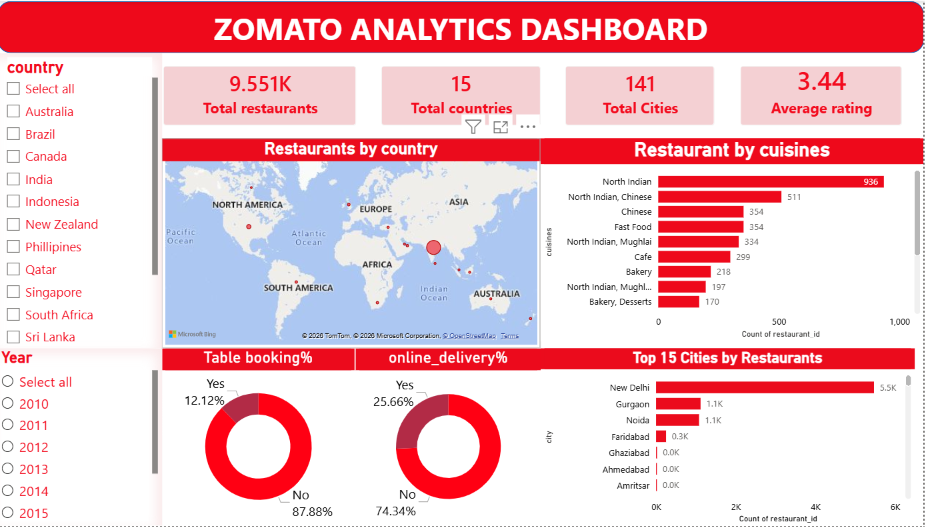

# Zomato-Dashboard
# Zomato-Restaurant-Analytics

1. Zomato Restaurant Analytics: From Raw Data to Business Insights

A data analysis project that turns raw Zomato restaurant data into clear KPIs, SQL-driven analysis and interactive dashboards across "Excel, MySQL, Power BI" to understand restaurant distribution, customer experience, pricing and service adoption.

---

2.📌 Short Description / Purpose

The Zomato Restaurant Analytics project analyzes restaurant data across 141 cities and 15 countries to answer a core business question: what can restaurant data tell us? The same dataset is developed across the full analytics workflow (cleaning, querying, visualizing and storytelling), making it useful for food-tech analysts, restaurant owners, marketing teams and market-expansion strategists who want to understand restaurant-market behavior.

---

3. 🛠️ Tech Stack

- 📗 Microsoft Excel: Data cleaning, KPI calculations, Pivot / Power Pivot and dashboard creation.
- 🗄️ MySQL: Data storage, SQL queries, and KPI and chart-level analysis.
- 📈 Power BI: SQL-based analysis, KPI cards and an interactive report/dashboard.
- 📁 File Formats: .xlsx, .sql, .pbix and .png for dashboard previews.

Workflow: `Data → Clean → Query → Visualize → Analyze → Insight`

---

4.  Data Source

Zomato restaurant dataset containing 9,551 restaurant records, with details on location, cuisine, pricing, ratings, votes and services.

Key fields used: Restaurant, Country, City, Cuisine, Rating, Votes, Price, Table Booking, Online Delivery, Opening Date.

| Metric | Value |
|---|---|
| Restaurants | 9,551 |
| Cities | 141 |
| Countries | 15 |
| Average Rating | 2.89 / 5 |
| Total Votes | 1,498,645 |
| Avg. Cost for Two | 1,199 |

---

5. Features / Highlights

 • Business Problem
Restaurant platforms hold large amounts of data, but raw records alone don't show where restaurants are concentrated, how customers rate them, or how widely digital services are adopted.

6. Key questions such as:
- Where are restaurants concentrated?
- Which cities and countries have the strongest restaurant presence?
- What do ratings, votes and pricing say about customer experience?
- How widely are online delivery and table booking adopted?
- Which cuisines and price segments are most common?

7. Goal of the Dashboard
 Turn business questions into measurable KPIs:
1. Measure scale: total restaurants, cities and countries.
2. Understand quality: average rating and rating distribution.
3. Understand demand: votes and restaurant concentration by city.
4. Understand pricing: average cost and price buckets.
5. Measure services: table booking and online delivery adoption.
6. Find preferences: top cuisines and restaurant categories.

8. Walkthrough of Key Visuals
- KPI Cards: 9,551 restaurants | 141 cities | 15 countries | 2.89 avg rating | 25.7% online delivery.
- Restaurants by Country: shows market concentration across countries.
- Restaurants by City: ranks cities by restaurant count, led by New Delhi, Gurgaon and Noida.
- Price Bucket Distribution: compares restaurants across cost segments.
- Rating & Votes Analysis: shows customer experience and engagement together.
- Service Adoption: online delivery vs. table booking share.
- Top Cuisines: identifies the most popular cuisine categories.

9. Business Impact & Insights
- India dominates: 8,652 restaurants (~90.6% of the dataset) are in India.
- New Delhi leads: 5,473 restaurants, followed by Gurgaon and Noida.
- Value segment is largest: the 0–500 price bucket contains 6,074 restaurants.
- Digital adoption has room to grow: online delivery is 25.7% and table booking is 12.1%.

10. Recommendations:
- Local market focus: use city-level analysis to identify high-density markets and expansion opportunities.
- Digital growth: target restaurants without online delivery for digital-ordering adoption.
- Value positioning: the large 0–500 segment shows strong demand for value-oriented restaurants.
- Customer experience: use rating and vote volume together to find restaurants with strong engagement.
- Cuisine strategy: use popular cuisines to guide menu positioning, partnerships and promotions.

---

11. Challenges & Learnings

**Challenges**
- Cleaning and standardizing restaurant fields.
- Handling missing and inconsistent values.
- Keeping KPI calculations consistent across tools.
- Validating SQL results against dashboard numbers.

**Learnings**
- Improved data cleaning and validation.
- SQL-based KPI analysis.
- Building dashboards in Excel, and Power BI.
- Data storytelling and presentation.

---

12. Screenshots / Demos

---

